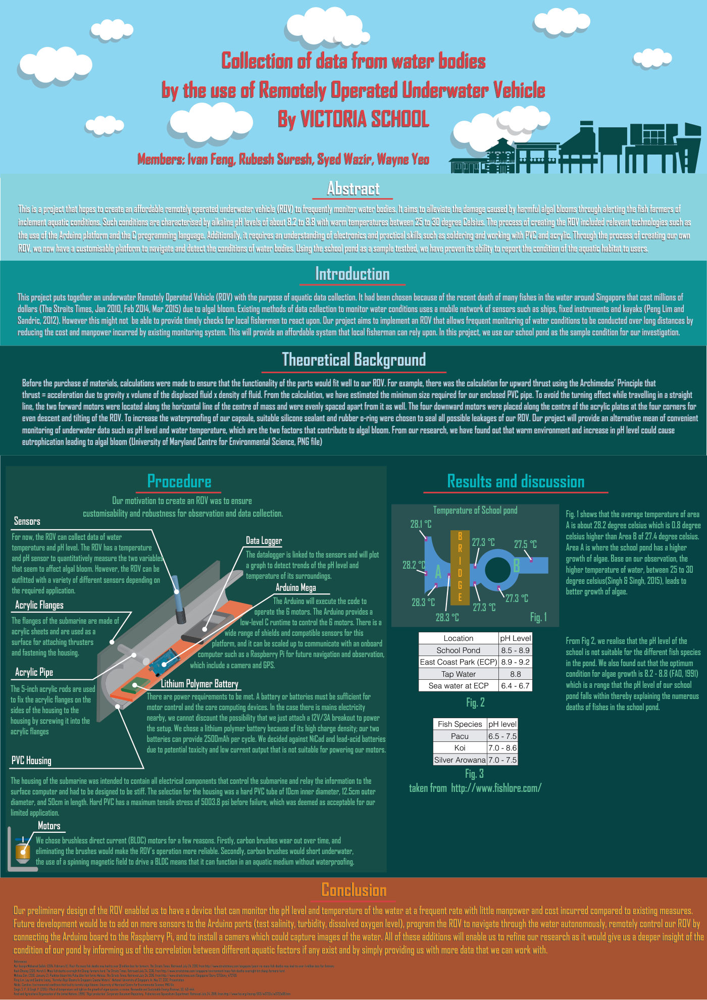

# OceanX

**An underwater robot that checks a pond's water for the conditions behind algal blooms.** 
A low-cost remotely operated vehicle (ROV): six brushless thrusters, a sealed PVC hull, an
Arduino Mega (ATmega2560) in embedded C++, and temperature and pH sensors with a data logger,
tested in Victoria School's koi pond.

**[Bronze Award, Upper Secondary category, East Zone A\*STAR Science Fair 2016](https://www.facebook.com/victoriaschoolsingapore/posts/congratulations-to-suresh-rubesh-4i-ivan-feng-4j-syed-wazir-4k-and-wayne-yeo-4kt/879824925455004/)**

> [!NOTE]
> This consolidated README page was added by
> [Claude Opus 5.5](https://docs.anthropic.com/en/docs/claude-code) in Nov 2026 using my
> [agentic-repo-analysis](https://github.com/sp4ce-cowboy/agentic-workflows) skill, from the
> team's poster, the official submission, and my earlier README. The project itself is from 2016.
> The poster's full text is in **[POSTER.md](POSTER.md)**; the original README is in
> **[README-ORIGINAL.md](README-ORIGINAL.md)**.

## At a glance

| | |
|---|---|
| **What** | An affordable underwater ROV that measures water temperature and pH, the two factors the team linked to algal blooms, so fish farmers can be warned early |
| **Context** | East Zone A\*STAR Science Fair 2016, and Victoria School's Social Innovation Project (Integrated Programme), 2016 |
| **Team** | Victoria School, represented by Ivan Feng, Rubesh Suresh, Syed Wazir and Wayne Yeo |
| **Recognition** | Bronze Award, Upper Secondary category ([Victoria School's post](https://www.facebook.com/victoriaschoolsingapore/posts/congratulations-to-suresh-rubesh-4i-ivan-feng-4j-syed-wazir-4k-and-wayne-yeo-4kt/879824925455004/)) |
| **Stack** | Arduino Mega (ATmega2560) in embedded C++, BLDC motors, temperature and pH sensors, a data logger, LiPo batteries, PVC and acrylic |

 

## The problem

Algal blooms had killed fish worth millions of dollars at Singapore's coastal fish farms (2010,
2014, 2015). Water was monitored by ships, fixed instruments and kayaks, which were too slow and
costly to warn farmers in time. Blooms follow warm water (25 – 30 °C) and alkaline pH (8.2 – 8.8),
so a cheap vehicle that measures both often could give that warning.

## How it was built

| Part | Choice | Why (from the poster) |
|---|---|---|
| Hull | Hard PVC tube, 10 cm inside diameter, 50 cm long, sealed with silicone and O-rings | Stiff enough to hold all the electronics; sized from a buoyancy calculation (Archimedes' principle) |
| Frame | Acrylic flanges and rods | A surface to mount the thrusters and fasten the hull |
| Thrusters | Six brushless DC (BLDC) motors: two forward, four vertical | Two forward motors either side of the centre of mass go straight without turning; four at the corners for even descent and tilt. Brushless motors don't wear out or short underwater |
| Control | Arduino Mega (ATmega2560), programmed in embedded C++ | Drives the six motors; many shields and sensors; can later talk to a Raspberry Pi |
| Sensing | Temperature and pH sensors, with a data logger that plots trends | The two variables behind algal growth |
| Power | Two LiPo batteries, 2,500 mAh per cycle | High charge density; NiCd and lead-acid were too toxic or too weak for the motors |

## Results

In the school pond, area A averaged 28.2 °C against 27.4 °C in area B, and had more algae. The
pond's pH was 8.5 – 8.9, inside the range where algae grow best (8.2 – 8.8), and above what most
of the pond's fish tolerate (pacu 6.5 – 7.5, koi 7.0 – 8.6), which explained the fish deaths there. Next steps on
the poster: more sensors (salinity, turbidity, dissolved oxygen), a camera, autonomous navigation
and a Raspberry Pi link.

The team's poster, the official submission ([full-size PDF](VJC%20Science%20Fair%20Challenge%20Final.pdf), [full text](POSTER.md)).

## Skills shown

| Skill | Where it shows (click the links for the poster) | Docs |
|---|---|---|
| **Embedded systems**  | Six-motor control and sensor logging on an Arduino: [poster](VJC%20Science%20Fair%20Challenge%20Final.pdf), Procedure | [Arduino Mega](https://docs.arduino.cc/hardware/mega-2560/) |
| **Mechanical design** | Buoyancy sizing, thruster layout around the centre of mass, waterproofing | |
| **Electronics** | Soldering, BLDC motors, LiPo power | |
| **Field testing** | Temperature and pH survey of a real pond, read against the literature | |

## On our resumes

**Skills:** Arduino · embedded C++ · BLDC motors · sensors and data logging · mechanical design · waterproofing · field testing

- Built a low-cost underwater ROV in a team of four, with six brushless thrusters, a sealed PVC hull and an Arduino Mega (ATmega2560) in embedded C++, to monitor water bodies for the conditions behind algal blooms.
- Sized the hull from a buoyancy calculation and placed the thrusters around the centre of mass (two forward, four vertical) for straight travel and even descent.
- Surveyed the school pond's temperature and pH with on-board sensors and a data logger, and tied the readings (pH 8.5 – 8.9) to algal growth and fish deaths there.
- Won the Bronze Award (Upper Secondary) at the East Zone A\*STAR Science Fair 2016.
